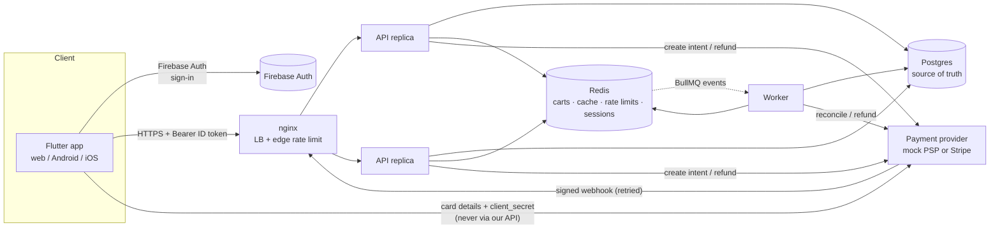
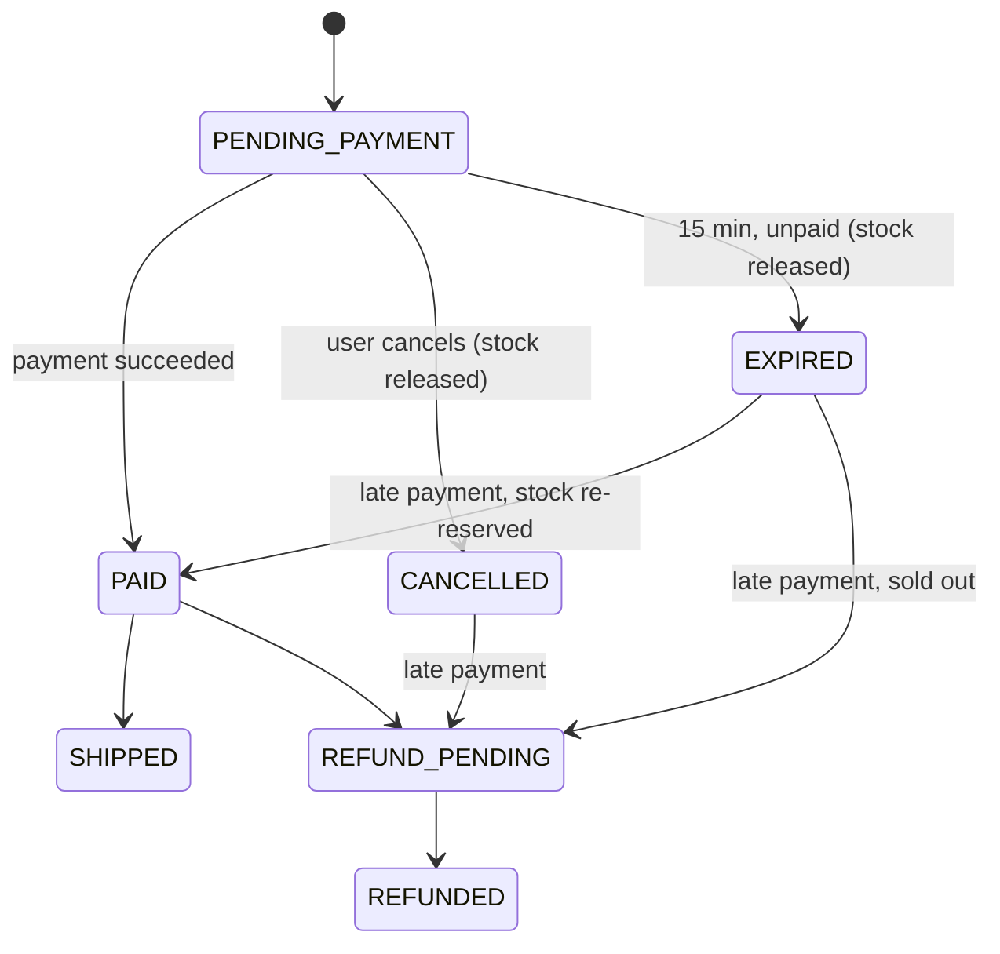

# ShopLon architecture

ShopLon is a small e-commerce system built the way a large one is. A Flutter app (web, Android and iOS)
talks to a stateless TypeScript API. Postgres is the source of truth, Redis absorbs hot writes, and
a worker runs everything asynchronous. Payments go through a pluggable provider: a bundled mock PSP,
or Stripe in test mode.

The aim is to show the system-design problems a real shop must handle correctly, and to show them working:

| Problem | How it's solved | Proven by |
|---|---|---|
| Two buyers, one item left | Row locks in primary-key order, plus a `CHECK (stock >= 0)` constraint | `flash sale` integration test and load test |
| Double-tapped "Pay" / client retries | Idempotency keys (claim with `INSERT … ON CONFLICT`, replay the stored response) | `idempotent checkout` tests |
| Very high cart write rate | Atomic Lua scripts on Redis, written behind to Postgres in coalesced batches | `cart under concurrent writes` tests |
| PSP delivers webhooks twice, late, or never | Event-id de-dup table, row-locked state machine, periodic reconciliation | `payments` tests, test cards `…0259` and `…0341` |
| Paid after the reservation expired | Re-reserve if stock is still there, otherwise refund automatically | `late payment` tests |
| Lost events between DB and queue | Transactional outbox, relayed with `SKIP LOCKED` | `order.paid` emitted exactly once (test) |
| Stolen or old session token | JWT verified locally against Google JWKS, plus server-side revocation on logout | `sessions` tests |
| Abuse and floods | Edge rate limit (nginx) + per-user limits shared via Redis; body-size caps | config |

## Topology



* **API** (`src/server.ts`): stateless. Any replica can serve any request (sessions are JWTs, carts are in
  Redis), so it scales horizontally: `docker compose up --scale api=4`.
* **Worker** (`src/worker.ts`): cart write-behind, outbox relay, expiry sweeper, payment reconciliation and
  event consumers. Every periodic task is safe to run on many replicas at once, so no leader election is needed.
* **Mock PSP** (`src/mock-psp/server.ts`): Stripe-shaped API with secret keys, idempotency keys, client secrets,
  asynchronous outcomes, HMAC-signed webhooks with retry, and failure-injecting test cards.

## Checkout and payment sequence

```mermaid
sequenceDiagram
  participant A as App
  participant API
  participant DB as Postgres
  participant P as PSP
  participant W as Worker
  A->>API: POST /v1/checkout (Idempotency-Key)
  API->>DB: claim idempotency key
  API->>DB: BEGIN; lock products ORDER BY id; decrement stock;<br/>insert order + items + outbox(order.created); COMMIT
  API->>DB: insert payment attempt (CREATED)
  API->>P: create intent (idempotency key = payment id)
  API-->>A: 201 order + client_secret (response stored under the key)
  A->>P: confirm(card, client_secret)
  P-->>A: processing
  P->>API: webhook payment_intent.succeeded (signed)
  API->>DB: BEGIN; insert webhook_events(event_id) — duplicate ⇒ stop;<br/>lock payment + order; PENDING_PAYMENT→PAID; outbox(order.paid); COMMIT
  A->>API: GET /v1/orders/:id (poll with backoff) → PAID
  W->>DB: relay outbox (SKIP LOCKED) → queue
  W->>W: order.paid → confirmation, ship after 60 s
```

There is no DB transaction open while the PSP is called. Holding row locks across a network call would
let a slow PSP stall every checkout. The intent is created *after* the order commits, with our payment id
as the PSP idempotency key, so a crash or retry at any point converges on a single intent.

## Inventory concurrency

`reserveStock` (`src/modules/orders/inventory.ts`):

1. `SELECT … WHERE id = ANY($ids) ORDER BY id FOR NO KEY UPDATE`. This locks only the rows being bought.
   Locks are always taken in id order, so two multi-item checkouts can never deadlock.
   `NO KEY` lets foreign-key inserts (cart flushes) proceed alongside it.
2. Check availability in code and return a precise shortage list (`409 OUT_OF_STOCK`).
3. Bulk `UPDATE … FROM unnest(...)`.
4. `CHECK (stock >= 0)` is the backstop: even a future bug can't oversell.

Stock is released exactly once. `orders.stock_reserved` is flipped by compare-and-set, so a cancel racing
the expiry sweeper cannot double-release.

**Why pessimistic locking?** For a hot item, optimistic concurrency (version columns) turns contention
into retry storms. Here each buyer holds a single-row lock for about a millisecond and the queue drains in
order. If a single SKU ever became the bottleneck, the next step would be a Redis `DECRBY` gate in front
of Postgres (admit only N buyers to the transactional path), then sharding stock into buckets.

## Cart: the high-write path

Carts are the most frequently written data and the least critical, so they live in a Redis hash per user
(`cart:{uid}`). Every mutation is a Lua script: read, cap at stock and at 10 per line, cap at 50 lines,
write, bump `__ver`, and mark the cart dirty. That all happens atomically in one round trip, with no locks.

The worker drains `cart:dirty` every 2 s with `SPOP` and writes carts to Postgres. A hundred taps cost one
DB write. Each flush is guarded by `UPDATE users SET cart_version = $v WHERE cart_version < $v`, so
concurrent or out-of-order flushes can never replace newer data with older data. If Redis loses a cart
(eviction or restart), the next request rehydrates it from Postgres. Redis runs with AOF `everysec`,
so the worst case is about 1 s of cart edits, an accepted trade-off for non-financial data.

Checkout reads the Redis cart, but prices always come from the locked product rows. Clients never send prices.

## Idempotency

`src/http/idempotency.ts`. The key is claimed with `INSERT … ON CONFLICT DO NOTHING` on `(user_id, key)`,
which is atomic across every replica.

| Situation | Response |
|---|---|
| First request | runs; the 2xx/4xx response is stored |
| Same key, finished | stored response replayed, with `Idempotent-Replayed: true` |
| Same key, still running | `409 REQUEST_IN_PROGRESS` + `Retry-After: 1` (the app waits and asks again) |
| Same key, different request | `422 IDEMPOTENCY_KEY_REUSED` |
| Handler crashed (5xx) | key released, so the client may retry |
| Owner died mid-request | taken over after `locked_until` |

The Flutter client creates one key per checkout tap and reuses it for network retries.

## Payments: correctness under an unreliable PSP

`handleProviderEvent` (`src/modules/payments/payments.service.ts`) serves both webhooks and reconciliation:

* **De-dup**: `INSERT INTO webhook_events (provider, event_id)` first; a duplicate stops there.
* **Verify**: HMAC-SHA256 over `timestamp.rawBody`, constant-time comparison, 5-minute replay window
  (Stripe's scheme). The raw body is kept for webhook routes only.
* **Amount check**: if the charged amount or currency differs from the order, the order isn't fulfilled
  and a refund is requested.
* **Every late-success path ends in "paid" or "refunded"**: expired → re-reserve or refund;
  cancelled → refund; already paid by another attempt → refund the duplicate.
* **Reconciliation** (every 30 s) asks the PSP about attempts open longer than a minute, or closed by
  expiry or cancel while possibly still in flight. This catches webhooks the PSP never delivered.

Order state machine (`order-state.ts`):



## Security

* **Authentication**: Firebase ID tokens (RS256) verified locally against Google's JWKS (cached), with
  issuer, audience, expiry and algorithm all pinned. No per-request network call.
* **Session revocation**: `POST /v1/auth/logout` records "tokens issued before now are invalid" in Redis.
  A copied token dies immediately instead of living up to an hour. If refreshing doesn't fix a 401, the app signs out.
* **Session persistence**: the Firebase SDK keeps the refresh token (IndexedDB on web, keychain/keystore
  on mobile). The app waits for session restore before choosing its first screen, and the API client
  refreshes and retries once on 401.
* **Authorization**: every query is scoped by `user_id`. Another user's order id returns 404, not 403,
  so ids can't be probed.
* **PCI scope**: card data goes from the browser directly to the PSP using a per-attempt client secret.
  The API never sees card numbers. Logs redact `authorization`, signatures, secrets and card fields.
* **Input**: zod schemas on every body, query and param; parameterised SQL only; 64 KB body limit;
  Fastify's JSON parser rejects `__proto__`/`constructor` poisoning.
* **Rate limits**: nginx per-IP at the edge, plus per-user limits in the API stored in Redis (so they hold
  across replicas): 300/min global, 120/min cart writes, 10/min checkout and pay.
* **Transport and headers**: CORS allow-list, Helmet headers, `/metrics` not exposed publicly,
  containers run as non-root.
* **Config**: validated at boot. The API refuses to start in production with dev tokens enabled,
  default webhook secrets, or Stripe selected without keys.
* **Firestore**: rules now allow only the owner's wishlist; everything else is closed to clients.

## Caching

The catalogue is public and read-heavy. It uses cache-aside in Redis with TTL jitter (so keys don't all
expire together), per-process single-flight (concurrent misses share one DB query), namespace versioning
for instant invalidation after a re-seed, ETag/304, and `Cache-Control` for a CDN. Stock shown in listings
may be up to ~30 s stale. That's fine, because checkout re-checks under a lock.

## Observability and operations

* Structured JSON logs (pino) with a request id that is propagated from nginx and returned to clients.
* Prometheus `/metrics`: request latency histogram, cache hit/miss, cart ops, cart flushes, checkout outcomes,
  idempotency outcomes, payment events by source.
* `/healthz` (liveness) and `/readyz` (Postgres + Redis). nginx and Compose route only to ready replicas.
* Graceful shutdown drains in-flight requests and jobs, so rolling deploys drop nothing.
* Migrations run once, under a Postgres advisory lock, even if many replicas start together.

## Measured (laptop, Docker Desktop, 2 API replicas)

`npm run load:flash-sale -- --buyers 500 --stock 25`

```
add to cart   500 req   p50  81 ms   p95 185 ms   p99 191 ms
checkout      500 req   p50 795 ms   p95 889 ms   p99 925 ms   (500 simultaneous, ~530 req/s)
responses     201 × 25, 409 OUT_OF_STOCK × 475
orders 25 · paid via webhook 25 · units sold 25 · stock left 0   ->  PASS (no overselling)
```

Checkout latency here is dominated by 500 requests queueing for 2 × 15 pooled connections, all
contending on one product row. That is the worst case by design.

## Scaling path

| Pressure | Next step |
|---|---|
| More API traffic | add replicas (stateless); put PgBouncer in front of Postgres for connection fan-in |
| Catalogue reads | CDN in front of `/v1/products` (already ETag- and Cache-Control-ready); read replicas |
| One extremely hot SKU | Redis `DECRBY` admission gate, then stock buckets |
| Cart volume | Redis Cluster (keys already hash-tagged `cart:{uid}`); shard the dirty set per slot |
| Orders table size | partition by month; archive closed orders |
| Event volume | swap the BullMQ relay for Kafka/SQS. The outbox pattern stays the same |
| Multi-region | regional API + Redis, single-writer Postgres with replicas, or move inventory to a dedicated service |
